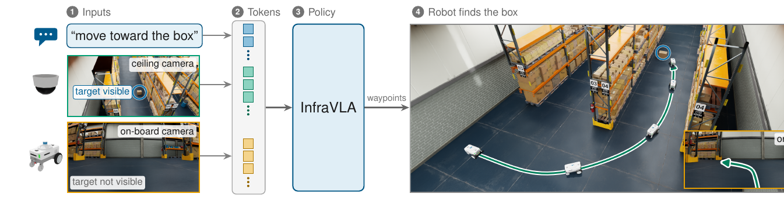
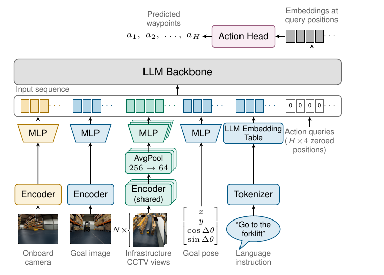

# InfraVLA: Extending Vision-Language-Action Navigation with Infrastructure Cameras



Many indoor environments in which robots operate, such as warehouses, offices and hospitals,
already have cameras installed. They observe parts of the building that the robot cannot see from
where it stands, yet navigation policies, including recent vision-language-action (VLA) models, do
not use them.

**InfraVLA** adapts a pretrained navigation VLA, [OmniVLA](https://omnivla-nav.github.io), to such
static infrastructure views. A dedicated CCTV encoder turns each external view into tokens of the
input sequence, and the policy is trained in two stages: first on demonstrations with upsampled
counterfactual data, then on recovery data mined from the policy's own rollouts.

This repository contains the code for the paper: the model, the Isaac Sim data generation and
evaluation harness, the two-stage training recipe, the recovery-data miner, the real-robot (Boston
Dynamics Spot) training and serving code, and the configurations of every reported experiment.

## Results

All success rates (SR) come from closed-loop rollouts. The baseline is OmniVLA fine-tuned on the same
data with upsampling, but without the CCTV encoder and CCTV input.

| Task | Baseline (no CCTV) | InfraVLA |
|---|--:|--:|
| Semantic task (sim): reach the object named in the instruction, 50 rollouts | 34.0 % | **100.0 %** |
| Spatial task (sim): reroute around blocked aisles, 72 scenarios | 73.6 % | **100.0 %** |
| Semantic task, held-out object placement | – | 88.2 % |
| Spatial task, held-out blocking patterns | – | 88.9 % |
| Real Spot, 24 rollouts, < 10 min of demonstrations | 29.2 % | **83.3 %** |

## Method



- **Architecture.** OmniVLA encodes the on-board image with DINOv2 + SigLIP and feeds it, with the
  goal (language, image or 2D pose), into a LLaMA 2 7B backbone whose regression head predicts
  8 future waypoints. InfraVLA adds a CCTV encoder, initialized from the on-board encoder, whose
  256 tokens per view are average-pooled to 64 and inserted after the on-board tokens. All linear
  layers are fine-tuned with LoRA.
- **Stage 1: counterfactual snippets and upsampling.** Pairs of demonstrations start from the same
  spawn and differ only in the instruction or the scene configuration. The window around the step
  where the two paths split is a counterfactual snippet. Snippets are upsampled to about half of the
  sampling mass, which creates the incentive to use the CCTV views.
- **Stage 2: recovery data.** The stage-1 policy is rolled out from inside the snippets. Once it
  derails, an A\* supervisor drives it back to the demonstrated path, and only that return segment
  is added to the training data (HG-DAgger style).

## Repository layout

The repository is a fork of [OmniVLA](https://github.com/NHirose/OmniVLA). Upstream files are kept
in place. InfraVLA code lives beside them.

| Path | Contents |
|---|---|
| `prismatic/`, `inference/`, `vla-scripts/train_omnivla*.py`, `config_nav/`, `experiments/` | Upstream OmniVLA / OpenVLA-OFT code. |
| `prismatic/extern/hf/modeling_prismatic_v2.py`, `vision_encoder.py` | The InfraVLA model: CCTV encoder, pooling, token insertion. |
| `prismatic/vla/datasets/cctv_isaac_sim_dataset.py`, `counterfactual_dataset_2.py`, `dataset_utils/` | Datasets, counterfactual-snippet upsampling, recovery mixing. |
| `vla-scripts/train_omnivla_sim_cctv_v2.py` | Training entry point for every simulated and real experiment. |
| `isaac_sim/` | Isaac Sim harness. `data_gen.py` (A\* demonstrations), `eval_policy.py` (closed-loop evaluation), `recovery/` (stage-2 miner), `run_builders/` (scene and experiment config generators), `configs/` (Hydra tree), `train/configs/` (one YAML per training run), `launchers/`. |
| `real_world/` | Spot: `train/` (fine-tuning on recorded demonstrations, LoRA merge), `live/` (policy server and operator loop), `analysis/` (test-arrangement sampling). |
| `scripts/` | The launch scripts used for the reported runs, kept as a record. |

Generated data, checkpoints and run outputs go to `runs/`, which is git-ignored.

## Installation

The code was run on Linux with an NVIDIA RTX PRO 6000 (96 GB). Training uses batch size 30. A single
closed-loop evaluation process needs 38 to 53 GB of GPU memory, so run one evaluation per GPU.

**1. Python environment.** Follow [SETUP.md](SETUP.md) to create the `omnivla` conda environment,
then install the repository with the InfraVLA extras:

```bash
conda create -n omnivla python=3.10 -y
conda activate omnivla
pip install numpy==1.26.4 torch==2.2.0 torchvision==0.17.0 torchaudio==2.2.0
pip install -e ".[infravla]"          # add ",real" for the real-robot tools
pip install packaging ninja
pip install "flash-attn==2.5.5" --no-build-isolation
```

`pyproject.toml` pins the [OpenVLA-OFT fork of `transformers`](https://github.com/moojink/transformers-openvla-oft.git).
Keep it. Stock `transformers` 4.40.1 reports the same version but lacks the bidirectional attention
the checkpoints were trained with, and silently produces collapsed predictions.

**2. Isaac Sim 5.1.** Data generation, evaluation and recovery mining need
[Isaac Sim 5.1](https://docs.isaacsim.omniverse.nvidia.com/) (binary install). Scene assets are
streamed from NVIDIA's public asset server, so no extra downloads are needed.

**3. OmniVLA checkpoint.** All policies start from the OmniVLA checkpoint at step 120k:

```bash
git clone https://huggingface.co/NHirose/omnivla-original
```

**4. Environment variables.** Run all commands from the repository root.

| Variable | Default | Meaning |
|---|---|---|
| `INFRAVLA_ROOT` | the repository root | Configs refer to data and checkpoint paths as `${INFRAVLA_ROOT}/...`. The main entry points and launchers set it automatically. Export it yourself before running other scripts. |
| `ISAACSIM_PATH` | `/isaacsim` | Isaac Sim install directory, used by the launchers. |
| `CONDA_ENV` | `omnivla` | Conda environment the launchers activate. |
| `PYTHON` | `python` | Interpreter used by the scripts in `scripts/`. |

```bash
export INFRAVLA_ROOT=$(pwd)
```

**5. Weights & Biases.** Training configs log to the W&B project named in `output.wandb_project`.
Set your own entity in `output.wandb_entity`, or pass `--disable-wandb`.

## Pipeline

### 1. Generate scenes and demonstrations

The run builders write scene configs, partitioned data-generation configs and a manifest. Data
generation then records A\* demonstrations in Isaac Sim.

```bash
# semantic task: object placements and language instructions
python isaac_sim/run_builders/build_2x3_lang.py --config isaac_sim/configs/datagen_2x3_langv2.yaml --tag langv2_new --date $(date +%F)
# spatial task: counterfactual families of blocked aisles
python isaac_sim/run_builders/build_2x3.py --tag cfv4_new --date $(date +%F)

# record every emitted partition
bash isaac_sim/launchers/run_datagen_partition.sh data_gen_2x3_<tag>_p1
```

The manifests in `isaac_sim/configs/experiment/` and the scene configs in
`isaac_sim/configs/_generated/env/scene/` are the exact ones behind the reported datasets. Use a new
`--tag` when generating, so the builders do not overwrite them.

### 2. Split into train and validation

```bash
# semantic task: split by scene family (all four instructions of a scene stay together)
python isaac_sim/utils/split_lang_twins.py --datasets runs/data_gen/<dataset> [<dataset> ...] \
    --prefix warehouse_2x3_langv2 --val-families 12 --seed 42 --out <split_name>
# spatial task: split counterfactual families by base index
python isaac_sim/utils/split_dataset_cf.py --manifest isaac_sim/configs/experiment/datagen_2x3_cfv4_manifest.json --runs-root runs/data_gen/<dataset> \
    --train-bases 1500:1750 --val-bases 1750:1774 --test-bases 1774:1775 --out <split_name>
```

Splits are written to `runs/data/splits/<split_name>/{train,val,test}`. The training configs expect
the split names used in the paper, for example `2026-07-22_warehouse_2x3_langv2` and
`2026-07-11_warehouse_2x3_cfv4`.

### 3. Train stage 1

```bash
python vla-scripts/train_omnivla_sim_cctv_v2.py --config isaac_sim/train/configs/2026-07-23_cctv4_avgpool64_langv2_yawcrux_pre3.yaml
```

Checkpoints are written to `runs/training/runs/<run name>/checkpoints/step_<N>/`. Add
`--smoke-test 3 --disable-wandb` for a quick check.

### 4. Mine recovery data

The miner rolls out a policy config from inside the counterfactual snippets of the training split and
records the supervisor's return to the demonstrated path. It runs inside Isaac Sim.

```bash
cd isaac_sim
python recovery/recovery.py policy=omnivla_langv2_pre3_best fine_grained.enabled=true \
    recovery.split_dir=$INFRAVLA_ROOT/runs/data/splits/2026-07-22_warehouse_2x3_langv2/train \
    recovery.output_root=$INFRAVLA_ROOT/runs/data/recovery/2026-08-11_A015k_langv2_recovery_t05_N48 \
    recovery.criterion=yaw recovery.yaw_eps_deg=1.0 recovery.window_pre_steps=3 recovery.window_post_steps=0 \
    recovery.rollout_dev_thresh_m=0.5 recovery.budget_factor=2.0 recovery.n_spawns=1 \
    recovery.quota=48 recovery.n_shards=3 recovery.shard=0 recovery.seed=0
```

Run one process per shard (`isaac_sim/launchers/launch_recovery_shards.sh` launches several at once).

### 5. Train stage 2

A stage-2 config resumes its stage-1 parent and trains 5k more steps on the snippet and recovery mix
named in its `dataset_manager` block. Copy the parent checkpoint into the new run directory, then
resume from it:

```bash
PARENT=runs/training/runs/2026-07-23_cctv4_avgpool64_langv2_yawcrux_pre3_v0/checkpoints/step_15000
RUN=runs/training/runs/2026-08-11_langv2_A0_dmrecext2_N48_ft20k_v0
mkdir -p $RUN/checkpoints/step_15000 && cp -a $PARENT/. $RUN/checkpoints/step_15000/
python vla-scripts/train_omnivla_sim_cctv_v2.py --config isaac_sim/train/configs/2026-08-11_langv2_A0_dmrecext2_N48_ft20k.yaml --resume-step 15000
```

### 6. Evaluate in closed loop

Each evaluation is a Hydra experiment config in `isaac_sim/configs/experiment/`, usually split into
shards (`_p1`, `_p2`, ...). The policy config it names points at the checkpoint to evaluate.

```bash
bash isaac_sim/launchers/run_eval_partition.sh lv2t_A0full_p1
```

Results land in the experiment's `recorder.runs_root` under `runs/evaluation/`, one `summary.jsonl`
line per rollout. `run_builders/build_langv2_eval.py` and `run_builders/build_2x3_grid72_endseal.py`
generate new semantic and spatial evaluation sets for other checkpoints.

## Citation

```bibtex
@misc{vierling2026infravla,
  title         = {{InfraVLA}: Extending Vision-Language-Action Navigation with Infrastructure Cameras},
  author        = {Vierling, Lukas and Ramtoula, Benjamin and Robinson, Luke and Clark, Ronald and De Martini, Daniele},
  year          = {2026},
  eprint        = {XXXX.XXXXX},
  archivePrefix = {arXiv},
  primaryClass  = {cs.RO}
}
```

## Acknowledgements

This code builds on [OmniVLA](https://github.com/NHirose/OmniVLA) by Hirose et al., which builds on
[OpenVLA-OFT](https://openvla-oft.github.io/). Their code is included because it is needed to
reproduce our experiments. We do not claim it or its methodology as our contribution. We thank the
authors for releasing it.

## License

MIT. See [LICENSE](LICENSE), which keeps the copyright notices of the OpenVLA-OFT and OmniVLA
authors.
